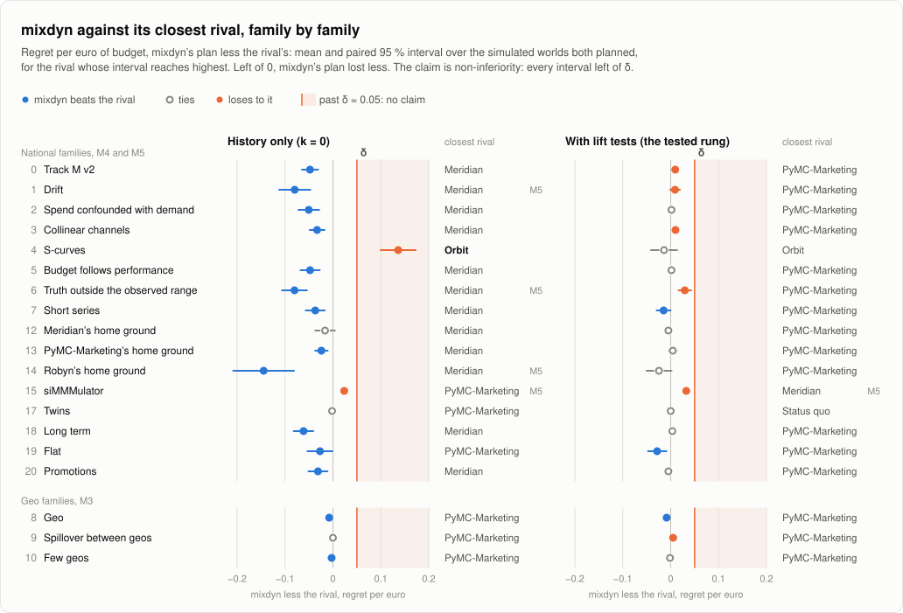
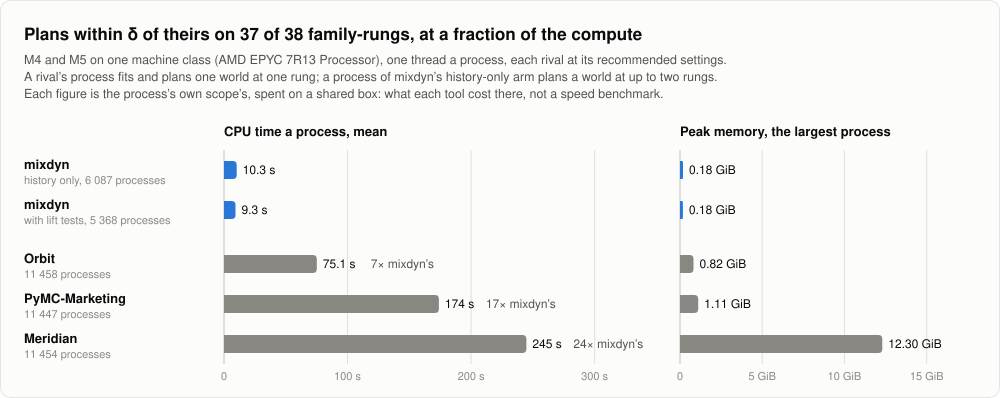
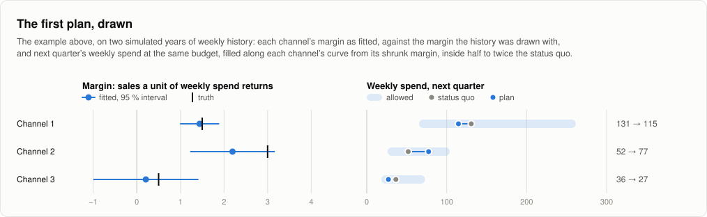

# mixdyn

[](https://github.com/causaldyn/mixdyn/actions/workflows/ci.yml)
[](https://pypi.org/project/mixdyn/)
[](https://pypi.org/project/mixdyn/)
[](https://github.com/causaldyn/mixdyn/blob/main/LICENSE)
[](https://causaldyn.github.io/mixdyn/)
[](https://scorecard.dev/viewer/?uri=github.com/causaldyn/mixdyn)
[](https://doi.org/10.5281/zenodo.24425629)

<!-- --8<-- [start:intro] -->
**Media-mix modelling that plans the budget, reads your lift and geo tests, and is scored in the
open against Meridian, PyMC-Marketing and Orbit.**

mixdyn is a media-mix modelling (MMM) engine in Python and JAX, built on
[causal-hybrid-control](https://github.com/causaldyn/causal-hybrid-control):

- **Models**: regressions, discount dynamic linear models, Bayesian models with lift and geo tests
  in the likelihood, and hierarchies over geos.
- **Experiments**: readers for lift and geo tests, and a test priced by what it adds to the plan
  before it runs.
- **Plans**: next quarter's budget split over channels, inside each channel's bounds, from a
  posterior or from each channel's margin.
- **Checks**: diagnostics, holdout scores, refreshes as weeks arrive, and each channel's
  sensitivity to an unmeasured confounder.

Its runtime is NumPy, SciPy, JAX and causal-hybrid-control, with what those bring in: no
probabilistic-programming language, no other MMM package, no UI. It does not do multi-touch
attribution (MTA): it reads no user-level path.
<!-- --8<-- [end:intro] -->

## How it measures up

<picture>
  <source media="(prefers-color-scheme: dark)" srcset="https://raw.githubusercontent.com/causaldyn/mixdyn/v0.3.0/docs/assets/closest-rival-dark.svg">
  
</picture>

<!-- --8<-- [start:measured] -->
On the [causaldyn bench](https://github.com/causaldyn/causaldyn-bench)'s simulated worlds, whose
optimal budget split is known, mixdyn's plans are within δ = 0.05 of regret per euro of budget of
those of Meridian 2.1.0, PyMC-Marketing 1.3.0 and Orbit 1.1.5.1, and of the status quo and the
equal split, on 37 of 38 pre-registered family-rungs. Three scored runs read them, M3, M4 and M5,
each pre-registration frozen before any confirmatory world was fitted. The one family-rung not
within δ is family 4, S-curves, with no lift test: there mixdyn's plan loses to Orbit's by +0.136
and to PyMC-Marketing's by +0.135 a euro, because the data do not identify television's curve
beyond the range its spend was logged in.

<!-- record:scoreboard -->
| Of 38 family-rungs, mixdyn | Meridian | PyMC-Marketing | Orbit | Status quo | Equal split |
|---|--:|--:|--:|--:|--:|
| beats the rival | 34 | 19 | 35 | 36 | 38 |
| ties | 1 | 11 | 1 | 2 | 0 |
| loses to it, within δ | 1 | 7 | 1 | 0 | 0 |
| loses to it, past δ | 0 | 1 | 1 | 0 | 0 |
| is not compared: the rival failed | 2 | 0 | 0 | 0 | 0 |
<!-- /record:scoreboard -->

Each count is of family-rungs, each read by Hall's reader at one-sided 0.025 over the worlds both
tools planned. This is a non-inferiority result on simulated worlds: it does not say that mixdyn is
the best MMM, and no real data has scored it yet. One maintainer built both the engine and the
bench that scores it. Every comparison, every loss, the pre-registrations, the versions and the
compute are on the [benchmark page](https://causaldyn.github.io/mixdyn/benchmark/).
<!-- --8<-- [end:measured] -->

<picture>
  <source media="(prefers-color-scheme: dark)" srcset="https://raw.githubusercontent.com/causaldyn/mixdyn/v0.3.0/docs/assets/cost-dark.svg">
  
</picture>

## Install

<!-- --8<-- [start:install] -->
```bash
pip install mixdyn        # Python 3.12 or later
```
<!-- --8<-- [end:install] -->

## A first plan

<!-- --8<-- [start:example] -->
```python
import numpy as np

from mixdyn import Cadence, Revenue, read_panel
from mixdyn.decisions import Range, plan_margins
from mixdyn.models import fit_margins

# Two years of weekly history: sales lifted by each channel's spend through a geometric adstock.
rng, weeks, names = np.random.default_rng(0), 104, ("tv", "search", "social")
spend = rng.uniform([60.0, 20.0, 15.0], [180.0, 80.0, 55.0], size=(weeks, 3))
kernel = 0.5 ** np.arange(8) / (0.5 ** np.arange(8)).sum()
carried = np.column_stack([np.convolve(s, kernel)[:weeks] for s in spend.T])
truth = np.array([1.5, 3.0, 0.5])  # each channel's margin, which the fit does not see
sales = 5000.0 + carried @ truth + rng.normal(0.0, 25.0, weeks)
dates = np.datetime64("2024-01-01") + np.timedelta64(7, "D") * np.arange(weeks)
data = {"week": dates, "sales": sales} | {c: spend[:, i] for i, c in enumerate(names)}
panel = read_panel(
    data,
    date="week",
    kpi="sales",
    spend={c: c for c in names},
    cadence=Cadence.WEEK,
    kpi_unit=Revenue(),
    currency="EUR",
)
fit = fit_margins(sales, spend, None, None, kernel=8)  # each margin, as the regression reads it

# Next quarter's weekly plan at the status quo's budget, within half to twice each status quo.
status_quo = spend[-52:].mean(axis=0)
limits = {c: Range(0.5 * q, 2.0 * q) for c, q in zip(panel.channels, status_quo, strict=True)}
plan = plan_margins(panel, None, 13, limits, kernel=8)
print("status quo", plan.current.round(1), "plan", plan.spend.round(1), fit.mean.round(2))
```
<!-- --8<-- [end:example] -->

<picture>
  <source media="(prefers-color-scheme: dark)" srcset="https://raw.githubusercontent.com/causaldyn/mixdyn/v0.3.0/docs/assets/first-plan-dark.svg">
  
</picture>

<!-- --8<-- [start:example-notes] -->
`plan_margins` is `margin held`, the rule the runs scored with no lift test
(`scorecard/arms/margin.py`), in one call: it reads each margin off a regression with saturating
curves, shrinks the margins together and fills the budget along the curves. `SKILL.md` walks one
panel through the Bayesian engine, gated at each step: read, fit, diagnostics, tests, plan, report.
<!-- --8<-- [end:example-notes] -->

## Learn more

- [Documentation](https://causaldyn.github.io/mixdyn/): the walkthrough, the scope, and the API
  reference with its versioning rules.
- [Benchmark](https://causaldyn.github.io/mixdyn/benchmark/): the full record of M3, M4 and M5,
  every table generated from the runs' records (`docs/benchmark.md`).
- `evidence/`: the scripts and records the decisions' measurements come from.

## Working on it

```bash
just sync    # .venv exactly as uv.lock has it
just check   # format, lint, types, the dependency gate, tests: what CI runs
```

Runtime packages are limited to `allowed-runtime-packages.txt`, and CI checks every push against
it. `docs/adr/` records the decisions the code relies on. `CONTRIBUTING.md` says how a change is
made and signed off, and `CHANGELOG.md` lists each release's changes.

## Licence

Apache-2.0 (`LICENSE`). Every redistribution carries `NOTICE`.
